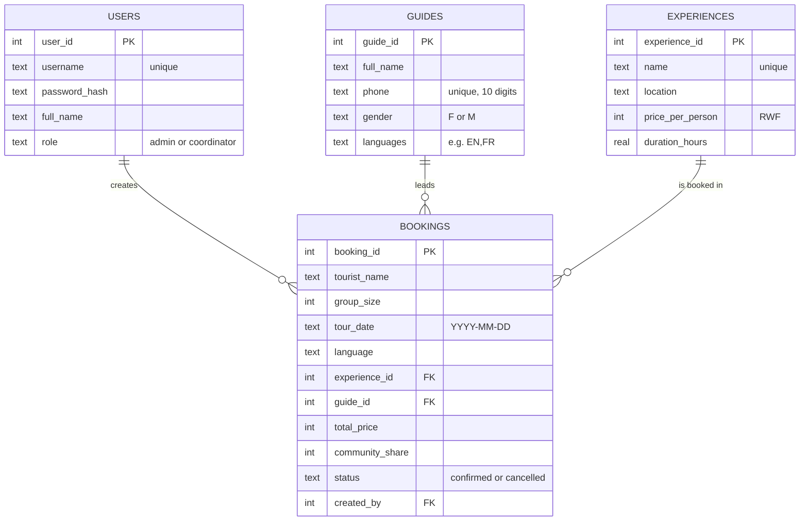

# Tembera Guide Connect

A menu-driven command-line app (Python + SQLite) that helps a **community tourism cooperative** register its local guides and tour experiences, book tourists onto a free guide who speaks their language, share tours fairly among guides, and report each guide's earnings and the money going to the community fund.

## The problem

Tourism is one of Rwanda's biggest sources of income: in 2024 the country earned USD 647 million and welcomed more than 1.3 million visitors (The New Times, 2025). Community tours such as village walks and craft workshops are part of what visitors buy. At the same time, 13.4% of Rwanda's labour force was unemployed in Q2 2025 (NISR), so steady tourism work matters for young people.

When a cooperative takes many tourist requests on paper, by phone and by email, it can easily:

- double-book a guide on the same day,
- send a tourist a guide who does not speak their language,
- give most of the work to a few experienced guides, and
- lose track of what each guide earned and what went to the community fund.

## Our solution

One simple tool for the cooperative's booking coordinator that:

- finds a **free guide who speaks the tourist's language** automatically,
- uses **fair rotation**: the guide with the fewest tours that month gets the next one, so new guides get work from their first month,
- calculates the price and the **10% community fund share** of every booking, and
- shows a **monthly earnings and community fund report**.

**GCGO links:** Tourism and Job Creation.

## User roles and features

| Feature | Admin | Coordinator |
|---|:---:|:---:|
| Log in (password stored as a SHA-256 hash) | Yes | Yes |
| Register / view / update / delete **guides** | Yes | View only |
| Add / view / update / delete **tour experiences** | Yes | View only |
| **Book a tour** (automatic fair guide choice) | - | Yes |
| View bookings for a date | Yes | Yes |
| Update a booking (name, group size, price recalculated) | - | Yes |
| Cancel a booking | - | Yes |
| View all bookings / delete a booking permanently | Yes | - |
| Register / view / update / delete **user accounts**, reset passwords | Yes | - |
| Monthly guide earnings & community fund report | Yes | Yes |

### Business rules

- A guide can have only **one confirmed booking per day** (no double-booking).
- The chosen guide must **speak the tourist's language** (EN, FR, KIN, SW).
- **Fair rotation:** among free guides who speak the language, the one with the fewest confirmed tours that month is chosen. If tied, the lower guide ID wins.
- **Total price** = price per person x group size. **Community fund** = 10% of the total. **Guide earnings** = total - community share.
- Guides and experiences that have bookings **cannot be deleted** (the database foreign keys protect the booking history).
- Cancelled bookings stay in the database but do not count in reports, and the guide becomes free again that day.

## Tech stack

- **Language:** Python 3 (only built-in modules: `sqlite3`, `hashlib`, `getpass`, `datetime`, `os`)
- **Database:** SQLite (one file, `database/tembera.db`, created automatically)
- No CSV or JSON storage: all data lives in the SQL database.

## Database design



The full schema is in [`database/schema.sql`](database/schema.sql) and the sample data in [`database/seed.sql`](database/seed.sql). All queries use `?` placeholders (parameterised queries).

## How the parts talk to each other

```
main.py  (start screen + login, checks the role)
   |
   +--> menus/admin_menu.py  or  menus/coordinator_menu.py   (what the user sees)
            |
            +--> services/*.py      (feature logic: booking rules, CRUD, reports)
                     |
                     +--> database/connection.py   (the ONLY file that talks to SQLite)
                              |
                              +--> database/tembera.db
```

Example - booking a tour: `coordinator_menu.book_tour_screen()` asks for the details -> `booking_service.create_booking()` calls `find_free_guide()` and works out the price -> `connection.insert()` runs the `INSERT INTO bookings` -> the new booking is read back and shown on screen.

## Folder structure

```
tembera-guide-connect/
  main.py                    # starts the app: start screen, login, role check
  reset_db.py                # rebuilds the database with fresh sample data
  requirements.txt
  README.md
  database/
    connection.py            # database connection + fetch_all/fetch_one/insert/execute
    schema.sql               # CREATE TABLE statements
    seed.sql                 # sample users, guides, experiences, bookings
  models/                    # classes (blueprints) for our objects
    user.py  guide.py  experience.py  booking.py
  services/                  # feature logic, calls the database layer
    auth_service.py          # login, password hashing, user accounts CRUD
    guide_service.py         # guides CRUD
    experience_service.py    # experiences CRUD
    booking_service.py       # fair guide choice + bookings CRUD
    report_service.py        # monthly earnings and community fund
  menus/                     # what each role sees
    admin_menu.py            # admin menu: guides, experiences, bookings
    user_accounts_menu.py    # admin: register and manage accounts
    coordinator_menu.py      # coordinator menu: book, update, cancel
    shared_screens.py        # screens both roles use (lists, report)
  utils/
    validation.py            # safe input: numbers, dates, phone, languages
    display.py               # tables, headers, money formatting
```

## Setup and run (Windows PowerShell)

1. Install Python 3.8 or newer from [python.org](https://www.python.org/downloads/) (tick "Add Python to PATH").
2. Clone the repository and open the folder:

   ```powershell
   git clone https://github.com/Umutoni-Rita/tembera-guide-connect.git
   cd tembera-guide-connect
   ```

3. Create and activate a virtual environment:

   ```powershell
   python -m venv venv
   .\venv\Scripts\Activate.ps1
   ```

   If PowerShell says running scripts is disabled, run this once and try again:
   `Set-ExecutionPolicy -Scope CurrentUser -ExecutionPolicy RemoteSigned`

4. Install requirements (there are no external packages, so this finishes instantly):

   ```powershell
   pip install -r requirements.txt
   ```

5. Run the app:

   ```powershell
   python main.py
   ```

The database is created automatically the first time. To start again with fresh sample data, run `python reset_db.py`.

## Default logins

| Role | Username | Password |
|---|---|---|
| Admin | `admin` | `admin123` |
| Coordinator | `coordinator` | `coord123` |

Passwords are hidden while you type them.

## Team and contributions

| Member | GitHub | Contribution |
|---|---|---|
| Umutoni Rita (team lead) | [@Umutoni-Rita](https://github.com/Umutoni-Rita) | Repository setup, `main.py` (start screen, login, role check), `reset_db.py`, README |
| Ishema Mudahinyuka Hugues | [@hishemah](https://github.com/hishemah) | Database: `schema.sql`, `seed.sql`, `connection.py` |
| Uwase Agnes | [@agnesuwase](https://github.com/agnesuwase) | Model classes, guide and experience services (CRUD) |
| Mico Dan | [@dm-alu](https://github.com/dm-alu) | Booking service (fair rotation, CRUD), report service, auth service, admin menu |
| Umuvandimwe Queen Carine | [@QueenCarine](https://github.com/QueenCarine) | Input validation, display helpers, coordinator menu, shared screens, user account menu |

## References

- KT Press. (2022). *Kwita Izina 2022: How Rwanda invested back Rwf7.9bn of tourism revenues in developing communities near parks.*
- National Institute of Statistics of Rwanda. (2026). *Rwanda Labour Force Survey 2025.*
- The New Times. (2025, April 14). *Rwanda's tourism generates $647m in 2024, eyes over $700m in 2025.*
